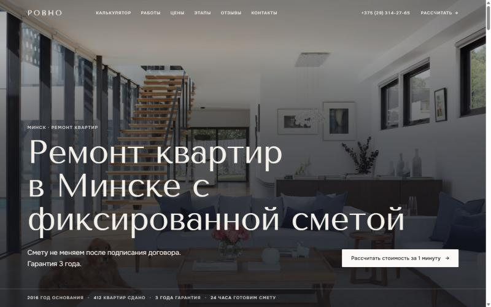
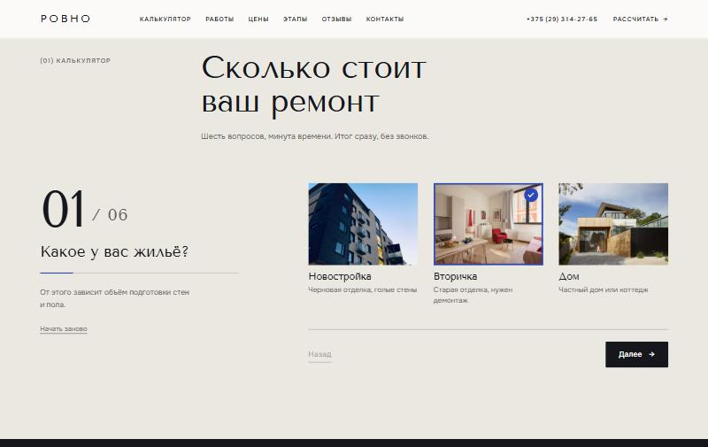
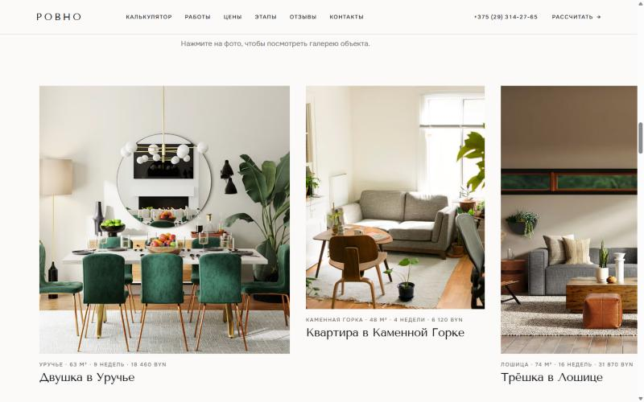
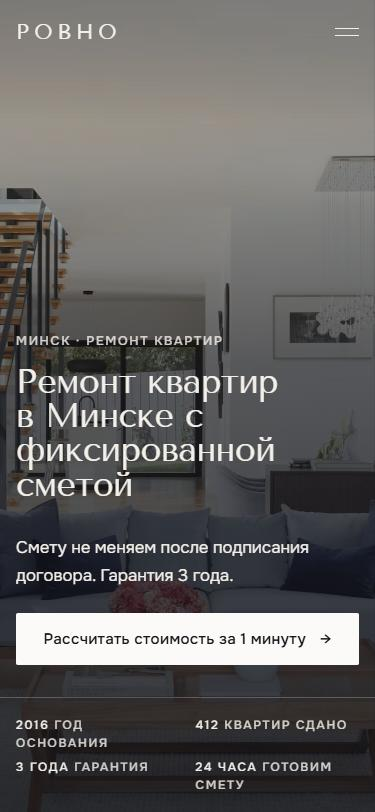

# Ровно — ремонт квартир в Минске

Адаптивный сайт ремонтной компании с квиз-калькулятором стоимости. Демо-проект для портфолио: бизнес вымышленный, формы данные никуда не отправляют.

Демо: https://nkorshun-remont.netlify.app



## Дизайн: «интерьерный журнал»

Редакционный стиль, как у журналов об интерьере и бюро дизайна: фото на первом месте, крупная спокойная типографика, тонкие линии вместо карточек, асимметричная 12-колоночная сетка.

- **Палитра:** фон #fbfaf8, «камень» #ebe7e1, «чернила» #15171c, один акцент — кобальт #2c47b8. Без градиентов, теней и оранжевого.
- **Шрифты:** Tenor Sans (заголовки), Onest 400/500 (текст и интерфейс). Запасные шрифты подогнаны по ширине, чтобы вёрстка не прыгала при загрузке.
- **Приёмы:** метки секций «(01) Калькулятор», углы 0–2px, кнопки без «пилюль», поля формы — только нижняя линия.
- **Анимации:** фото раскрываются шторкой (clip-path), текст плавно поднимается, подчёркивание ссылок растёт слева, лёгкий zoom фото. Всё отключается при prefers-reduced-motion.
- **Секции:** прозрачная шапка поверх фото во весь экран; квиз 5/7 колонок с фото-плитками; смета в виде «счёта»; один большой слайдер «до/после» на тёмном фоне; горизонтальная лента работ; цены в три колонки; этапы с «липким» фото; отзывы по одной цитате; футер с огромным логотипом.

| Квиз | Портфолио | Телефон |
|---|---|---|
|  |  |  |

Lighthouse (локально): мобильный — производительность 95, доступность 100, best practices 100, SEO 100; десктоп — 99 / 100 / 100 / 100.

## Возможности

- Квиз из 6 шагов с прогресс-баром и плитками с фото, ответы сохраняются в localStorage, кнопка «Начать заново».
- Смета: диапазон ±12%, срок в неделях, разбивка по позициям.
- Слайдер «до/после»: мышь, касание, клавиши ←/→, Home/End (role="slider"), переключатель объектов «01 02 03».
- Портфолио — горизонтальная лента (колесо, тач, стрелки, полоса прогресса) и полноэкранная галерея (`<dialog>`); отзывы со счётчиком «3 / 8»; FAQ-аккордеон.
- Формы в демо-режиме: валидация, маска телефона +375, имитация отправки, номер заявки.
- Доступность: aria-live, видимый фокус, навигация с клавиатуры, prefers-reduced-motion.
- SEO: title, description, Open Graph, canonical, JSON-LD (HomeAndConstructionBusiness).

## Стек

HTML5, CSS3, ванильный JavaScript (ES-модули). Без сборки и зависимостей. Фото — Unsplash по прямым ссылкам.

## Структура

```
index.html, 404.html
css/   variables.css, base.css, components.css, sections.css
js/    main.js, quiz.js, estimate.js, before-after.js,
       phone-mask.js, validation.js, ui.js, data.js
img/   favicon.svg, og-image.jpg, screenshots/
netlify.toml, README.md, .gitignore
```

## Как устроена смета

`js/estimate.js` — чистые функции (`calcEstimate`, `formatMoney`), не трогают DOM. Все цифры лежат в `js/data.js`:

- `repairTypes[].pricePerM2` — цена работ за м² (74 / 156 / 248 BYN);
- `housing[].coef` — коэффициент типа жилья (1.0 / 1.08 / 1.15);
- `bathroom.price`, `bathroom.separateExtra` — цена санузла и доплата за раздельный;
- `options[]` — доп. опции: `perM2` (за м²) или `fixed` (фиксированная цена);
- `range` — диапазон итога (0.12 = ±12%).

Формула: `работы = площадь × цена за м² × коэффициент`, `санузлы = количество × (цена + доплата)`, плюс опции. Итог «от…до» = сумма ∓ 12%, округление до 10 BYN.
Чтобы поменять цены, правьте только `data.js`.

## Запуск локально

Нужен любой статический сервер (ES-модули не работают с `file://`):

```
npx serve .
```

Откройте адрес из консоли (например http://localhost:3000).

## Деплой на Netlify

1. Загрузите папку в репозиторий (GitHub) и подключите его в Netlify или перетащите папку на app.netlify.com/drop.
2. Build command пустая, publish directory — `.` (уже указано в `netlify.toml`).
3. Замените `https://nkorshun-remont.netlify.app/` в `index.html` (canonical, og:url, og:image, JSON-LD) на свой адрес.
